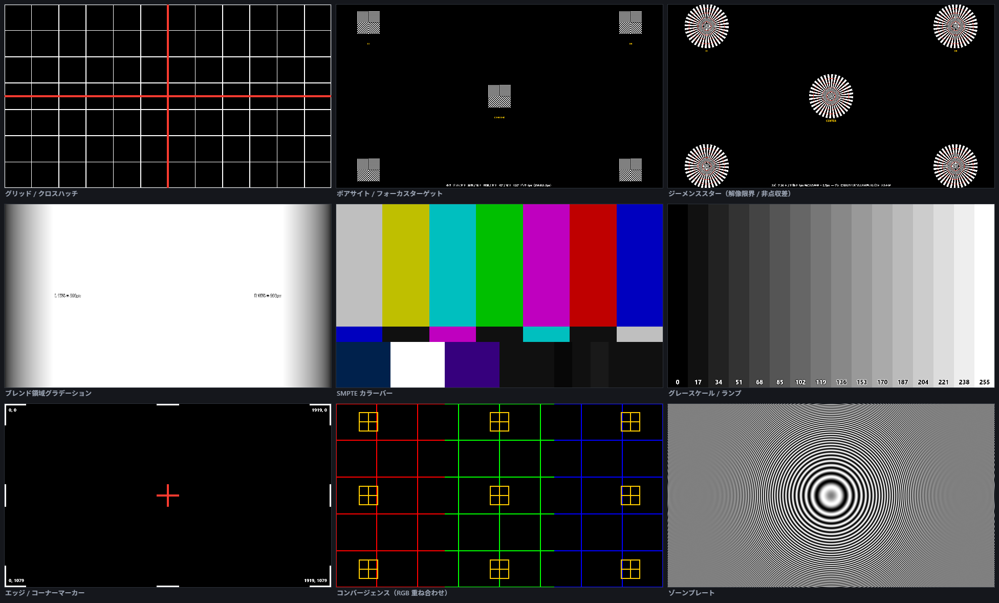

# TestPattern Studio

ディスプレイ / プロジェクタ調整用のテストパターン・テストトーン発生アプリ（Windows / Electron）。



任意の解像度を入力すると、**その解像度で数式からパターンを再描画**する（画像の拡大ではないので、
`5760x1080` や `1234x567` のような変則的な解像度でも線幅・升目・微細パターンが正しく出る）。
NDI 出力は持たず、PC が認識しているディスプレイ（HDMI 等）へ直接フルスクリーン出力する。

- **プロジェクタ調整系**（Vioso Testpattern Simulator 相当）: グリッド、ドットグリッド、
  ブレンド領域グラデーション、エッジ / コーナーマーカー、ジオメトリ、フォーカス、ブランキング
- **フォーカス / ボアサイト調整系**（Christie 等の内蔵パターン相当）: ボアサイトターゲット、
  ジーメンススター、コンバージェンス
- **映像品質系**（NDI Test Patterns 相当）: SMPTE カラーバー、EBU / 100% / 75% バー、
  グレースケール、単色ベタ、PLUGE、マルチバースト、ゾーンプレート、RGB 単色面
- **動的パターン**: スクロールバー、動くボックス、フレームカウンタ
- **テストトーン**: Sine / Square / Triangle / Saw / White / Pink、周波数スイープ、L / R / 交互
- **区画ラベル**: 画面を N 分割して `L / C / R` 等の大きな半透明文字を重ねる。
  5760x1080（1920 × 3 面）のようなマルチ画面でどの面かを判別するためのもの

解像度はプリセット選択か任意入力。任意解像度でもパターンは**その解像度で数式から再描画**される
（画像の拡大ではない）。NDI 出力は持たず、PC が認識しているディスプレイ（HDMI 等）へ直接出力する。

## 動作環境

- Windows 10 / 11 (x64)
- 開発時のみ Node.js 20 以降

## 使い方

```bash
npm install
npm start
```

ビルド済みの実行ファイルだけ欲しい場合は [ビルド](#ビルド) を参照。

| 操作 | 内容 |
| --- | --- |
| 左ペイン | パターン選択（↑ ↓ キーでも切替） |
| 右ペイン「パラメータ」 | 選択中パターンの調整項目（パターンごとに自動生成） |
| 右ペイン「オーバーレイ」 | 区画ラベル（L / R / C 等）・解像度表示・任意テキスト・セーフエリア・アスペクト枠などの重ね描き |
| 右ペイン「音声」 | テストトーン |
| 上部「解像度」 | プリセット / 任意入力 / 出力先ディスプレイの実解像度を取り込み |
| 上部「出力先」 | フルスクリーン表示するディスプレイを選択 |
| 上部「スケーリング」 | 論理解像度 ≠ ディスプレイ解像度のときの表示方法 |
| `F5` | 出力ウィンドウの開閉 |
| 出力ウィンドウで `Esc` | 閉じる |
| `Ctrl + S` | 論理解像度そのままの PNG を保存 |

設定（パターンごとのパラメータ・解像度・オーバーレイ・音声）は自動保存され、次回起動時に復元される。

### スケーリングモード

| モード | 挙動 |
| --- | --- |
| Fit | アスペクトを維持して全体が入るよう縮小 / 拡大（レターボックス） |
| Native 1:1 | 等倍で中央に配置。はみ出し分は切れる。ピクセル等倍の検証用 |
| Stretch | 出力全面に引き伸ばす |

## ビルド

```bash
npm run dist
```

`dist/` に以下が生成される。

- `TestPattern Studio Setup <version>.exe` — NSIS インストーラ
- `TestPatternStudio-<version>-portable.exe` — 単体実行ファイル

ビルドせず動作だけ確認したい場合は `npm run dist:dir`（`dist/win-unpacked/` に展開のみ）。

| スクリプト | 内容 |
| --- | --- |
| `npm start` | アプリ起動 |
| `npm run dev` | DevTools を開き、レンダラの console をターミナルへ流して起動 |
| `npm run icon` | `build/icon.ico` を生成（依存なしの自前生成） |
| `npm run gallery` | 全パターンを一覧描画する開発用チェックページを http で配信 |
| `npm run dist` | インストーラ + portable exe |
| `npm run dist:dir` | 展開のみ |

## 構成

```
src/
  main/          Electron メインプロセス（ウィンドウ / ディスプレイ列挙 / IPC / PNG 保存）
  renderer/
    control/     コントロール UI
    output/      出力ウィンドウ（描画専用）
  shared/
    core.js            パターンレジストリ + 描画ユーティリティ
    resolutions.js     解像度プリセットと検証
    render.js          オフスクリーン描画 → 表示 Canvas へのスケーリング転送
    overlay.js         共通オーバーレイ
    patterns/
      projector.js       グリッド / ブレンド / マーカー等
      focus-advanced.js  ボアサイト / ジーメンススター / コンバージェンス
      video.js           カラーバー / グレースケール等
      dynamic.js         スクロール / 動くボックス / フレームカウンタ
    audio/tone.js      テストトーン発生器
docs/patterns.png       README 用のパターン一覧画像
tools/
  gallery.html         全パターンを一覧描画し、変則解像度でも例外が出ないか走査する開発用ページ
  serve-gallery.js     上記を http で配る開発用サーバ
  make-icon.js         build/icon.ico の生成（カラーバー + グリッドの意匠）
SPEC.md                仕様書
```

### パターンの追加

`src/shared/patterns/*.js` に 1 オブジェクト追加するだけでよい。
`params` 配列から右ペインの UI が自動生成されるので、UI 側の修正は不要。

```js
TP.registerPattern({
  id: 'mypattern',
  name: '新しいパターン',
  category: 'projector',      // projector | video | dynamic
  animated: false,            // true なら requestAnimationFrame で回る
  hint: '何を確認するためのパターンか',
  params: [
    { key: 'pitch', label: 'ピッチ (px)', type: 'number', default: 100, min: 2, max: 4096, step: 1 },
    { key: 'color', label: '線の色', type: 'color', default: '#ffffff' },
    { key: 'on', label: '有効', type: 'bool', default: true },
    { key: 'mode', label: 'モード', type: 'select', default: 'a', options: [{ v: 'a', l: 'A' }] },
  ],
  draw(ctx, { w, h, p, frame, time, fps }) { /* 論理解像度 w x h に描く */ },
});
```

新しいファイルを足した場合は `src/renderer/control/index.html` と
`src/renderer/output/output.html` の両方に `<script>` を追加する。

## 既知の制限

- **色の厳密性**: Chromium は 2D canvas のバッファをディスプレイのカラースペースのものとして扱うため、
  出力先ディスプレイに sRGB 以外の ICC プロファイルが割り当たっていると、指定した RGB 値が
  そのまま HDMI に出ない可能性がある。`--force-color-profile=srgb` 等のフラグは効かないという報告が
  複数あり、確実な回避策は確認できていない。色が主題のパターン（SMPTE / PLUGE / グレースケール）を
  厳密に使う場合は、出力先ディスプレイのプロファイルを sRGB に揃えること。
  なお **PNG 書き出しはこの影響を受けない**（オフスクリーンの readback なので意図した値が保存される）。
- **音声はステレオ 2ch まで**。5.1 / 7.1 の ch 個別出力は WebAudio では環境依存が大きいため未対応。
  必要になった場合は音声部のみネイティブ（WASAPI）へ分離する想定。
- **フレームカウンタの絶対精度**: コンポジタの遅延が測定値に乗るため、機器間の相対比較には使えるが
  絶対的な遅延量の実測には向かない。
- 連番 / 動画書き出しは未対応（PNG 静止画のみ）。

## ライセンス

MIT License — [LICENSE](LICENSE) を参照。
